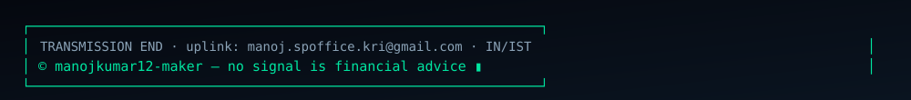

<picture>
  <source media="(prefers-color-scheme: dark)" srcset="assets/banner.svg" />
  
</picture>

<p align="left">
  <a href="https://github.com/manojkumar12-maker?tab=repositories"></a>
  <a href="https://github.com/manojkumar12-maker?tab=followers"></a>
  
  <a href="mailto:manoj.spoffice.kri@gmail.com"></a>
</p>

---


| STATUS | MODULE | FUNCTION |
|:------:|--------|----------|
| ● | [**binance-signal-engine**](https://github.com/manojkumar12-maker/binance-signal-engine) | live crypto signals, Dockerized — Python core + UI on Fly.io |
| ● | [**AICluster-Studio**](https://github.com/manojkumar12-maker/AICluster-Studio) | multi-agent IDE for cluster workflows, repo intelligence & monitoring |
| ● | [**JL-Trading-Engine**](https://github.com/manojkumar12-maker/JL-Trading-Engine) | Node execution system with db layer, deployable on Fly.io |
| ● | [**Krishna-District-Police**](https://github.com/manojkumar12-maker/Krishna-District-Police) | district admin portal — auth, dashboard, audit-log modules |

<p align="left">
  <a href="https://github.com/manojkumar12-maker/binance-signal-engine">
    
  </a>
  <a href="https://github.com/manojkumar12-maker/AICluster-Studio">
    
  </a>
</p>

<p align="left">
  <a href="https://github.com/manojkumar12-maker/JL-Trading-Engine">
    
  </a>
  <a href="https://github.com/manojkumar12-maker/Krishna-District-Police">
    
  </a>
</p>

---


```text
$ whoami
  mathangi.manoj.kumar — full-stack developer, Machilipatnam, IN

$ cat focus.conf
  trading_systems  = [binance signals, order engines]
  ai_tooling       = [multi-agent orchestration, cluster workflows]
  web_stack        = [react, next.js, node, python]

$ tail -1 changelog
  shipping binance-signal-engine … status: DEPLOYED ▮
```

---


<p align="left">
  
  
</p>

<p align="left">
  
</p>

<p align="left">
  
</p>

<p align="left">
  
</p>

---


<p>
  
</p>
<p>
  
</p>

---


